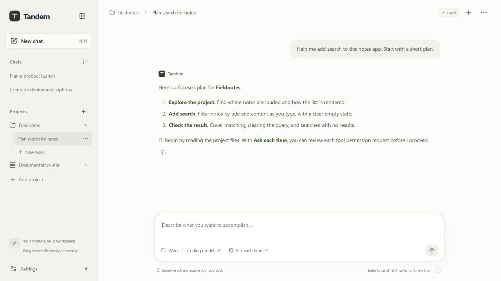
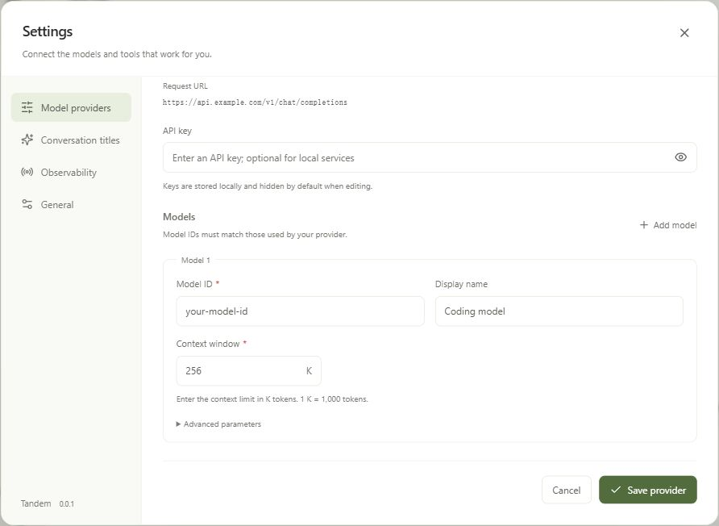
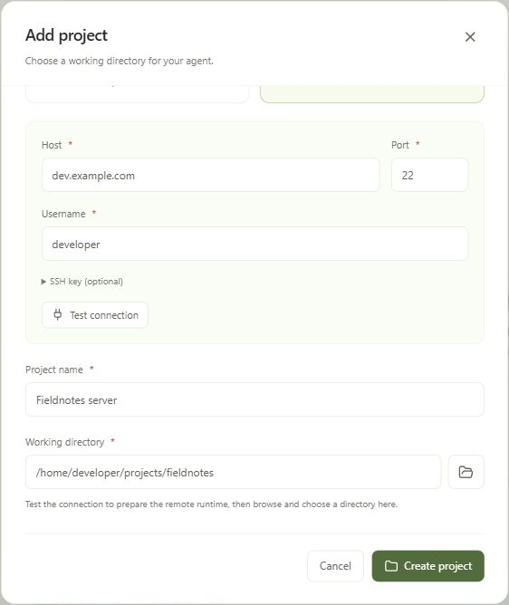

# Tandem

An agent desktop for chat, local projects, and SSH work. Bring your own model provider and API key to ask questions, explore a codebase, edit files, and run project tasks.

No GitHub Copilot subscription is required. Available for Windows and Apple Silicon Mac.

[Download](https://github.com/caibirdme/Tandem/releases) · [Get started](#get-started) · [User guide](docs/user-guide.md) · [Troubleshooting](#troubleshooting) · [Development](docs/development.md)



_Keep project conversations and model selection together in one workspace. Screenshots use illustrative data and may show an earlier interface._

## What you can do

- **Chat with your models.** Connect OpenAI-compatible APIs, Anthropic, or your own model gateway. Chat can read web pages.
- **Include images and files.** Paste an image or drop files into the composer, review the previews, and send them with your message.
- **Work where your files are.** Open a local directory or connect to a Linux x86_64 host over SSH. The agent can read and edit files and run commands.
- **Review code changes.** Open **Changes** in a Work conversation to compare current workspace, session, or individual-turn changes. Review requires Git 2.45 or newer on the execution host; see the [review guide](docs/user-guide.md#review-code-changes).
- **Choose how the agent works.** Work uses full access automatically. Switch models and choose `low`, `medium`, `high`, `xhigh`, or `max` reasoning effort for each conversation, according to the model's supported values.
- **Delegate independent work.** Select **Expert team mode** in the Work composer to let the main agent coordinate subagents. Open an agent from its collaboration card to inspect live output, thinking, and tool calls in the right-hand detail panel. Select another agent to switch the panel; close it or press Escape to return to the unchanged conversation layout. Drag the divider, or focus it and use the arrow keys, to adjust the width. On narrow windows the panel fills the screen.

## Install

Download an installer from [Releases](https://github.com/caibirdme/Tandem/releases):

| System                | Installer       |
| --------------------- | --------------- |
| macOS (Apple Silicon) | `.dmg`          |
| Windows (x64)         | `x64-setup.exe` |

On macOS, drag Tandem into Applications. The app is not signed or notarized by Apple; before opening it for the first time, run:

```sh
xattr -dr com.apple.quarantine /Applications/Tandem.app
```

## Get started

### 1. Connect a model

Open **Settings > Model providers > Add provider**. Choose OpenAI Chat Completions, OpenAI Responses, or Anthropic Messages, then enter your provider's base URL and API key.

Click **Fetch models** to open the model catalog. Each row has a checkbox, the model name, its context window, and a chevron that expands its parameters. Select the models you want and click **Add selected**. Tandem copies the returned context and output limits and leaves default reasoning effort unset. The **Model list path** inside the dialog defaults to `/v1/models`, appended to the base URL, and can be changed for your gateway. Discovery uses the Anthropic Models API format regardless of the conversation protocol.

Use **Add model** to enter a model manually in a separate dialog. Enter its required context window in **K** (1 K = 1,000 tokens), such as `256` for 256k or `1000` for 1M. Added models appear in a compact list; click a row to edit its populated form. Save the provider to keep all changes. See the [provider guide](docs/user-guide.md#configure-a-provider) for catalog import requirements and reasoning choices.



_Use your provider's model IDs and check the request URL preview before saving._

### 2. Start a conversation

- **For questions:** choose **New chat**, select a model, and send a message. Chat exposes web reading tools and approves their permission requests automatically.
- **For project tasks:** choose **Add project**, select a local directory, then create **New work** in that project. Select a model, describe your task, and send it.

Work uses **Full access** by default, with no permission selector or first-message confirmation. Tool requests are approved automatically. Commands run with your user account's access on the execution machine.

The first message prepares the bundled runtime automatically. To use Simplified Chinese, open **Settings > General > Language**. Choose **Font size** in the same section for Small, Medium (the default), or Large text; changes apply immediately and are saved on this device.

Paste images with **Ctrl+V** (**Command+V** on macOS), drag files into the composer, or use the attachment button. Remove an attachment with its **×** before sending. Attachments also work in local and SSH project conversations. See [Images and files](docs/user-guide.md#images-and-files) for limits and history.

### 3. Connect an SSH project

Log in once with your system terminal to confirm the host fingerprint and set up a key or ssh-agent. In **Add project > Remote project**, select a saved host from your local SSH config and click **Test connection**. Tandem reuses its username, port, keys, and jump hosts. You can also choose **Enter manually** to enter connection details. Use the folder button (**Browse directories**) beside **Working directory** to select a remote folder, then create the project.



_Choose a remote directory in the project dialog, then start work with the same conversation controls._

**Test connection** only verifies SSH access; it does not upload the server or prepare its runtime. Sending the first message checks the remote environment and prepares it automatically only if needed; there is no initialization button. New conversations reuse a healthy remote environment without repeating the preparation notice. During preparation, the message stays pending while Tandem shows progress; first use may take about 10 seconds, or longer depending on the host and connection. Tandem prepares the remote agent over SSH without opening an additional remote network port. Multiple Work conversations on the same host share a background runtime while keeping independent connections and permissions. See the [SSH guide](docs/user-guide.md#ssh-projects) for supported hosts and setup details.

## Troubleshooting

### What should I do if Tandem reports invalid or incompatible configuration?

First check whether the error identifies a specific provider, model, API key, URL, or CLI setting. Correct that setting instead of deleting your data.

If Tandem cannot read its saved local data because it is corrupt or incompatible, you can reset that data and reopen the app. **This is a recovery option for saved-data problems, not a fix for every configuration or compatibility error.**

1. Stop any active work and quit Tandem completely. Do not clear data while Tandem or its local agent runtime is still running.
2. Open the data directory for your operating system:

   | System                | Local data directory                                                                                      |
   | --------------------- | --------------------------------------------------------------------------------------------------------- |
   | Windows               | `%LOCALAPPDATA%\app.tandem.desktop`                                                                       |
   | macOS                 | `~/Library/Application Support/app.tandem.desktop`                                                        |
   | Linux (source builds) | `$XDG_DATA_HOME/app.tandem.desktop`, or `~/.local/share/app.tandem.desktop` when `XDG_DATA_HOME` is unset |

   On Windows, paste the path into File Explorer's address bar. On macOS, use Finder's **Go > Go to Folder**.

3. Back up the entire directory somewhere private, then clear its contents. Alternatively, rename the directory to `app.tandem.desktop.backup` to keep the old data while starting fresh.
4. Reopen Tandem. It creates fresh local data automatically. Add your providers, API keys, models, and projects again.

**This resets saved provider settings and API keys, project entries, conversation history, stored attachments, and local agent runtime state.** The directory contains `tandem.sqlite3` (including API keys stored in plaintext) and `runtime/`; protect your backup and do not upload it to a public issue. Project files outside this directory and data on SSH hosts are not deleted by this reset.

Resetting this directory does not repair incorrect credentials or provider settings you enter again, network or SSH failures, filesystem permissions, missing application resources, or an incompatible external CLI. Environment overrides such as `COPILOT_CLI_PATH`, the SDK’s separate runtime cache, and remote-host state are outside this reset. A remote-server compatibility error calls for reconnecting the project to deploy the matching server, not clearing local data.

If the error persists with fresh data, report the error text, Tandem version, and operating system in [Issues](https://github.com/caibirdme/Tandem/issues), without sharing API keys or the data directory.

## Run from source

Install Node.js 24, pnpm 12, Rust 1.99.1, [just](https://github.com/casey/just#installation), and the [Tauri development prerequisites](https://v2.tauri.app/start/prerequisites/) for your system.

On macOS, install Xcode Command Line Tools; on Windows, install Visual Studio C++ Build Tools and WebView2. Tests also require Python 3.10 or later. Install the pinned test dependencies with `python3 -m pip install -r tests/requirements.txt` (use `python` on Windows), preferably in a virtual environment; `just setup` also installs them.

On Windows, install just with `winget install --id Casey.Just --exact` and install [Git for Windows](https://git-scm.com/downloads/win). Run the commands below in Git Bash with `sh` on `PATH`.

```sh
just setup
just dev
```

For the first local desktop build, run `just desktop-build-full`. Use `just desktop-build` for subsequent builds, and the full command again after remote server sources change. Both build the desktop executable for development verification without an installer and take no arguments. Release installers are built in GitHub CI; use `just desktop-bundle` locally when checking packaging changes.

Mac builds produce the Mac desktop and Windows builds produce the Windows desktop; both include the same Linux x86_64 server. Ordinary builds validate that server and need no Docker. Full builds prepare it when missing or outdated; start Docker Desktop or a Docker-compatible engine such as Colima when it needs rebuilding. The build does not start or switch engines. Before using SSH projects in `just dev`, run `just remote-build`. See [Packaging and remote artifacts](docs/development.md#packaging-and-remote-artifacts).

Tandem uses React, Tauri 2, and Rust services built on GitHub Copilot SDK 1.x from crates.io. `Cargo.lock` currently resolves SDK `1.0.25`, and its matching Copilot CLI `1.0.102` is bundled automatically.

## Learn more

- [User guide](docs/user-guide.md): provider setup, model switching, permissions, context usage, SSH, and telemetry.
- [Development](docs/development.md): checks, browser development, packaging, and releases.
- [Architecture](docs/architecture.md): execution modes, service boundaries, and data flow.
- [Verification](docs/verification.md): current checks, manual acceptance, and PR evidence requirements.
