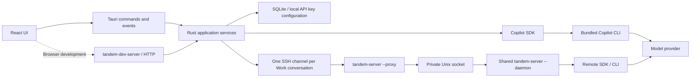

# From a message to project work

Users configure a provider, then choose chat or project work. Both share history, model selection, and streaming display. The difference is runtime configuration: chat receives only web tools; work receives the selected directory and file/command tools, with per-session approval or full access.

After a conversation starts, users can still change its model or provider beside the composer. The next message uses the new selection and continues the existing history. Switching and sending share a session lock. Switching is rejected while running or waiting for approval; once the selection is saved, the old connection is invalidated and cleaned up, then the same SDK session ID resumes with the new configuration. The UI displays the selection only after service confirmation and offers reconfirmation after connection failures, keeping the displayed model consistent with actual inference.

Users can also choose reasoning effort beside the composer before or after starting a chat or Work session. The provider model's `reasoningEffort` is the default; nullable `Session.reasoningEffort` stores a conversation override, with `null` following that default. The override is independent of model selection and survives reopening and application restarts. Changes are allowed during generation and pending tool approval: they save the next-turn setting without interrupting the active turn. Before the next send, the core compares the resolved effort with the live connection's effort and resumes the same SDK session if it changed. Local and SSH sessions receive the resolved value through the existing runtime model configuration. The UI confirms saves and recovers uncertain results before allowing the next send.

## Responsibilities and dependencies

`tandem-core` stores projects, provider configuration, sessions, and messages, manages active sessions, and converts runtime events into UI events. It does not depend on Tauri, so desktop and browser development modes call the same service.

`copilot-runtime` adapts only the official SDK. The SDK handles model requests, tool execution, context compaction, and session recovery. The application owns tool allowlists, permission requests, provider mapping, and telemetry parameters; it does not maintain a second agent loop.

`tandem-remote` owns system SSH, platform detection, atomic deployment, and bidirectional JSON RPC with request IDs. Each remote Work conversation opens an SSH channel running `tandem-server --proxy`. The proxy forwards bounded frames through a private Unix socket to a shared `tandem-server --daemon`; it does not start an SDK or CLI. Provider keys pass through SSH and the socket in memory; they are not written to remote preference files or process arguments.

### Shared remote runtime

Users can start several Work conversations on the same host, including in different project directories. Each conversation keeps its own model, provider, permissions, history, and SSH connection. A shared daemon owns one Copilot SDK client and CLI for the same Unix user, canonical home directory, and build identity. The server embeds an identity derived from its relevant source, manifests, lockfile, toolchain, target, and build options. Copies and concurrent uploads of the same artifact share the daemon even when atomic deployment changes the file's inode. A different build selects a separate daemon so incompatible builds never share live sessions. Old daemons exit after their connections close and the idle deadline expires.

The proxy starts the daemon on demand. A startup lock prevents simultaneous proxies from launching multiple daemons, and a lifetime lock protects socket creation and stale-socket cleanup. Socket and lock files live in a private `0700` directory under the canonical system `/tmp`, keyed by UID and home identity; short paths also support long home directories on macOS. Peers must have the same UID, and the socket handshake verifies protocol and binary identity. Both locks are regular private files and remain in place after exit to avoid lock-file replacement races. No public TCP listener is created.

Connection tests and runtime preparation also use the daemon. `--install-runtime` reuses its current runtime, avoiding a temporary CLI for each connection. Skill scans use that same runtime through an idle conversation's existing proxy when available, or a temporary proxy otherwise. The isolated `--stdio` mode remains available for protocol verification, including on Windows; SSH execution uses `--proxy`.

The daemon accepts at most 64 connections, with independent bounded output queues and request limits. Each connection reserves capacity for stop, approval, and disconnect commands. Long preparation or skill discovery does not serialize unrelated sessions. Request IDs are scoped to their connection. Sessions have one connection owner, events go only to that owner, and commands from another connection are rejected. Prepared messages are single-use and tied to the session; abort or disconnect invalidates both pending and in-progress preparation. The desktop also rejects an event whose session ID differs from its conversation.

Losing a connection aborts and detaches only that connection's sessions, denying unanswered approvals and discarding prepared messages. Other connections and the shared CLI remain usable. An explicit later send opens a new proxy and resumes the persisted SDK history; submitted tasks are never automatically replayed. The desktop persists the output it received as interrupted. This policy does not continue unattended work or replay output missed during an outage. An SDK failure invalidates all sessions using that CLI; a later connection can rebuild it. If the SDK cannot confirm abort or detach, the daemon closes all connections and exits, forcing the CLI to stop when graceful shutdown fails, times out, or is cancelled. Uncertain work is never left running without a connection owner.

Telemetry is process-wide. Every desktop skill scan and session start supplies the desired settings. A healthy runtime can change settings only when no session or operation holds it; conflicting settings while it is in use return a typed conflict. Provider and model settings remain per session. After the last proxy disconnects, the daemon retains the CLI for five minutes, then flushes telemetry and exits. Termination signals perform the same cleanup.

`tandem-dev-server` forwards local development HTTP requests to `tandem-core`. The production desktop calls `tandem-core` directly through Tauri without an HTTP host. Remote execution needs neither project management, SQLite, nor system credential stores. The development host and remote agent therefore have separate binary entry points.

`tandem-protocol` contains shared RPC frames, serialization, size limits, and error types. It depends only on Serde, JSON, Tokio, and error support, with no application service, SSH client, or SDK dependency. Sharing the protocol cannot pull local application features into the remote agent.

| Module              | Allowed workspace dependencies       | Responsibility boundary                                                                     |
| ------------------- | ------------------------------------ | ------------------------------------------------------------------------------------------- |
| `tandem-desktop`    | `tandem-core`                        | Tauri windows, native directory selection, and command/event bridging                       |
| `tandem-core`       | `copilot-runtime`, `tandem-remote`   | Application rules, history, and credentials; no window or HTTP framework                    |
| `copilot-runtime`   | None                                 | SDK sessions, permission boundaries, and telemetry adaptation                               |
| `tandem-remote`     | `tandem-protocol`                    | SSH client, remote deployment, and transport                                                |
| `tandem-protocol`   | None                                 | Shared RPC format and frame I/O                                                             |
| `tandem-server`     | `copilot-runtime`, `tandem-protocol` | Remote agent; no `tandem-core`, `tandem-remote`, Axum, SQLite, or credential store          |
| `tandem-dev-server` | `tandem-core`                        | Local HTTP development entry point; excluded from remote and desktop distribution resources |

The application command entry point only dispatches requests and serializes results. Providers, projects, and sessions each own validation, concurrency rules, and persistence. `AgentHandle` contains the differences between local and remote agents; conversion from events to UI history is maintained separately. Session states and message roles use enums while retaining the existing JSON strings externally.

A pure reducer centralizes frontend session state changes; subscriptions and requests remain in hooks. Form submission rules are separate from components, so history merging, late events, and key retention/deletion can be tested without starting the desktop. Both SSH endpoints share framing and size limits. Connection tests inject I/O to cover broken streams and write failures directly.

## Message attachments

Users paste clipboard images, drop files, or choose files in the composer, then review or remove them before sending. The same message path serves Chat, local work, and SSH work, including messages containing only attachments.

The UI reads explicitly selected files into bounded base64 inputs. Rust validates attachment counts, decoded sizes, names, MIME syntax, and encoding before changing session state. Each message accepts at most 10 files, with a 10 MiB per-file limit and a 20 MiB combined limit. Desktop IPC and the development HTTP host call the same service; HTTP and SSH frames allow 32 MiB for base64 expansion and message text.

The application stores attachment bytes in a separate SQLite table, atomically with their user message. Ordinary history carries only IDs, names, MIME types, and sizes. `get_attachment` retrieves bytes for a specific conversation and attachment; snapshots do not include attachment contents. Foreign keys remove stored copies when their message, session, or project is deleted.

The remote preparation request carries actual attachment contents over SSH, never a path on the user's computer. The runtime adapts those inputs to the locked SDK's Blob attachment interface. It normalizes generic image/PDF types and UTF-8 source or text files to MIME types the runtime handles; unsupported binary content is rejected before persistence instead of silently disappearing from the provider request. PDF input requires OpenAI Responses or Anthropic; OpenAI Completions submissions are rejected before persistence. Original bytes and supplied MIME metadata remain available in storage. Explicitly supplied attachments do not expand Chat's web-only tool allowlist or change Work permission policy.

## Typed failures

When an operation fails, users receive an actionable message and can retry after correcting the indicated settings or session state. Rust services return domain-specific `thiserror` enums: validation, persistence, API key storage, runtime configuration, title inference, SSH, and RPC framing each preserve distinct failure reasons. `tandem-core::Error` composes these errors and enumerates application conflicts such as changing a running conversation's model. Callers match variants rather than inspecting message text. Underlying I/O, SQLite, JSON, and SDK causes remain available through error sources where they do not expose private input; sensitive parse errors retain only their category and location, and title inference retains only a safe failure variant.

Desktop IPC and development HTTP serialize command failures as `{code, error}`. The code is one of `invalid_input`, `not_found`, `conflict`, `unavailable`, or `internal`; HTTP maps these to 400, 404, 409, 503, and 500 respectively. The frontend retains both fields in `CommandError`. SSH RPC failure envelopes carry `{id, error: {code, message}}`, with `RpcErrorCode` distinguishing invalid payloads, missing approvals, disconnected sessions, busy runtimes, timeouts, and other remote failures. The SSH client preserves that code until the application boundary maps it to the corresponding command category. Display messages may change without changing recovery logic.

## Interface language

The application defaults to English, independently of the operating system language. Users can switch to Simplified Chinese in **Settings > General > Language**. The selection applies immediately and is saved under `tandem.locale` in the local browser/webview storage; only the language preference is stored there. Startup applies that preference before rendering the interface.

`src/i18n/` owns the locale registry and typed message catalogs. Components select messages by stable keys rather than embedding translated copy. English defines the message shape, and other catalogs must provide the same keys and compatible message parameters. Use the active locale when introducing user-facing date or number formatting. Adding a language requires a catalog and a locale registry entry; it does not require changing component behavior. Untouched session-title placeholders use the selected language, identified by existing `titleState: "pending"` metadata; generated and manually saved titles retain their original values. User content, model IDs, paths, and backend diagnostic details also retain their original values.

## Chat boundaries

The runtime uses the SDK's bare configuration mode, disabling environment plugins, file hooks, and automatic configuration discovery. Chat also disables skills and exposes only `builtin:web_fetch` to the model. All SDK tool permission requests are approved automatically, without creating pending approvals or confirmation dialogs. The tool allowlist restricts available capabilities, and the chat prompt explicitly asks the agent to call tools directly.

This controls agent tool capabilities. The CLI still needs to save sessions, logs, and runtime state in the application's private directory; the application does not claim to provide an operating-system sandbox. Work is also not a directory sandbox, and commands can access content outside the project directory.

## Work permission modes

Each work session stores `permissionMode`, either `ask` or `allow-all`. New work sessions default to asking each time. Ask mode shows each SDK permission request as an approval card; full access approves automatically without pending approvals. Chat always approves tool permission requests automatically, ignores this field, and offers no permission switch.

Both local and remote session creation/recovery receive the permission mode again. Changes are allowed only when no task is active; the service rejects switches while running or waiting for approval. Switching disconnects the existing agent. The next explicit send resumes the same session with the new mode, preserving history without replaying tasks. The frontend also blocks sending while a switch is pending so concurrent requests cannot use an unexpected mode.

If the save response is lost, the UI reads the actual permission mode from the service. If that read fails, it displays a pending confirmation state, keeps sending and switching disabled, and offers **Confirm permissions again**. Actions resume only after confirmation, preventing the UI from showing an old mode while the runtime has already adopted a new one.

Bare configuration removes the SDK's default environment context. Work prompts therefore include the normalized project path explicitly and require file tools to use absolute paths based on it. The SDK session configuration still provides the shell working directory. Chat prompts contain no host directory.

Work explicitly enables the SDK's skill support and `builtin:skill` tool, loading only the selected project's `.agents/skills` and the execution user's `~/.agents/skills`. Creation and recovery apply the same configuration. The `$` picker preloads metadata from the runtime on the project's execution host and shares a bounded, in-memory project cache for 60 seconds. Expired entries stay visible during refresh. Missing or invalid sources are skipped; discovery failures retain the last catalog, or show an empty list when none exists, and can be retried by reopening. Failures and timeouts remain typed across the service boundary rather than being cached as successful empty scans.

SSH discovery reuses a connected, idle conversation's transport for the same project, releasing the session-map lock before the RPC and retaining that conversation's operation gate until discovery finishes. This prevents a turn from starting concurrently with a borrowed scan. It never shuts down that shared transport. When no idle connection is available, discovery creates and closes a temporary proxy connected to the same daemon. This avoids holding an active conversation's operation gate while scanning; the daemon also reserves request capacity for approvals and cancellation. Skill roots and candidate paths are validated in blocking filesystem batches so large catalogs do not occupy the async executor or schedule a separate worker task per filesystem operation.

Explicit selections travel as names and paths alongside message text, are freshly validated against the same roots by the runtime, and are expanded through the native skill command API before sending. Chat and title generation retain their disabled skill configuration. See [Project skills](skills.md) for directory layout, interaction, and the protocol research.

Sent user messages render explicitly selected skills as inline chips with a skill icon. The renderer uses selection metadata to distinguish them from ordinary `$text` in the message.

## History and API keys

SQLite stores user-visible history and configuration; Copilot's own session state lives in a private application runtime directory. Tandem resumes SDK sessions with the same UUID and reapplies provider, tool, and permission configuration. Deleting a project deletes its conversations. A provider's associated conversations must be handled before the provider can be deleted.

API keys are stored in plaintext in the application's local SQLite database, named `tandem.sqlite3`. The separate `provider_secrets` table keeps keys out of conversation messages. Omitting `apiKey` in settings requests preserves the existing value; an explicit empty string clears it. Ordinary snapshots return only `hasApiKey`. The provider editor reads the actual value on demand through `get_provider_api_key`, displays a password field by default, and lets users reveal it. Keys are never written to browser persistent storage, logs, or command-line arguments.

The desktop and development host use the same local storage implementation without system credential stores. A development host started with `--data-dir` uses independent storage in that directory. `--ephemeral-secrets` explicitly enables an in-memory store for tests only; credentials disappear when the process exits.

The desktop application identifier is `app.tandem.desktop`, which selects its application data directory. The development host uses its configured data directory. Both store the database as `tandem.sqlite3` and SDK session state in its `runtime/` subdirectory.

The remote executable is deployed to `~/.local/share/tandem/bin/tandem-server`. Remote SDK state uses `~/.local/share/tandem/runtime`.

## Automatic titles

After the first completed reply, `tandem-core` asks a model to summarize the title in the background. The title model is stored independently in preferences and can be any configured provider model; without an explicit selection, it follows the session's model. Changing title settings does not restart active chat or work. Users can request another title through **Regenerate title** in the conversation options menu.

Summarization receives only bounded user text and the assistant's final reply from the first complete turn. It skips interrupted replies and pre-tool introductions, and explicitly marks the content as data to summarize. `copilot-runtime` creates a separate temporary session with all tools, permissions, and configuration discovery disabled, while retaining the provider's model and token parameters. Completion, failure, or cancellation triggers time-bounded cleanup. Title replies never enter the user's chat history. Titles for both local and SSH work are generated locally, so the remote protocol does not need settings or history management.

Title tasks limit concurrency and wait time. Failure displays only a retryable title error without changing the main session state. Manual naming, deleting sessions or projects, and updating model configuration invalidate stale results. Successful titles are persisted and update the list and active session through a separate event. Snapshots include sessions with title generation in progress so reconnecting can restore the UI state.

## Events and interruption

Users read the progress sentence directly, then click the smaller category row or its leading chevron to inspect that stage's tools. Each tool can expand further to show its arguments and output. The category reflects known tool types and shows no call counts; when no intent is supplied, only the category row appears. While a stage is running, a white highlight repeatedly sweeps across the intent sentence from left to right; completion, failure, or interruption returns it to static text. Reduced-motion preferences disable the highlight. Tool activity is collapsed by default, while intent sentences, final responses, tool failure notices, and permission requests remain visible. Assistive technology can still read the stage's status.

`copilot-runtime` preserves the SDK's human-readable `assistant.intent`, message/tool identities, and tool lifecycle details. Intent is ephemeral in the SDK, so `tandem-core` captures intent text and tools in durable `activity` messages alongside ordinary conversation messages. It groups tools by meaningful progress updates rather than creating a section for every model iteration. Assistant text associated with tools becomes the group's visible intent sentence without appearing twice. The optional SDK `phase` remains provider metadata; it is not assumed to have Codex's commentary/final-answer semantics.

Tool starts determine group ownership. Later progress, completion, and error events update the same tool and group, even after another stage begins. Arguments and results are separate fields. Stable message identities and storage sequence preserve ordering when activity messages are updated or history is loaded. Activity message upserts follow the same local and SSH application event path as ordinary messages. The frontend renders these records and keeps disclosure state by their stable identities.

Completed groups and tool details remain in SQLite when a subsequent message starts. Unfinished tools become interrupted when a task ends without their completion event or the application recovers after a restart. Pending approvals retain their existing snapshot and single-use request behavior.

Users can expand a separate **Thinking** header to read provider-supplied thinking text as it arrives. `ThinkingMessage` starts collapsed and limits its expanded scroll region to three lines. New text scrolls into view while the user remains at the bottom; scrolling upward preserves the reading position until the user returns to the bottom. Waiting, completed, and interrupted states have distinct labels.

`copilot-runtime` forwards text only from explicit SDK `assistant.reasoning_delta` and `assistant.reasoning` events. It excludes opaque reasoning payloads and unrelated reasoning fields. `tandem-core` groups the exposed text by runtime reasoning identity into messages with `role: "reasoning"` and `reasoning.status`, using stable message IDs for streamed updates. It saves the first chunk and lifecycle transitions in SQLite while retaining intervening text in memory. History and reconnect reads overlay that current text on persisted records. Stopping or failure saves unfinished thinking as interrupted; startup also marks unfinished persisted records interrupted.

Work users can inspect current context usage in the circular indicator beneath the composer. `copilot-runtime` adapts SDK `session.usage_info` into `context_usage {currentTokens, tokenLimit}`; the used count comes from the SDK, while `tokenLimit` uses the configured total context window because the SDK reports the smaller prompt budget after reserving output tokens. It does not sum `assistant.usage` billing counts. Local and SSH sessions use the same event path. Invalid counts are discarded, and over-limit readings retain their actual values while the UI bounds the ring to 100%. `tandem-core` persists only the latest Work reading as nullable `Session.contextUsage`, allowing snapshots and application restarts to restore it. Chat ignores these readings. Changing models or saving the provider clears the old reading; provider saves also emit a null `context_usage` update. Existing frontend session revisions prevent stale snapshots from replacing newer readings.

SDK text fragments stream to the UI. Once a complete reply is persisted, it replaces the temporary bubble. The service retains the current turn's fragments and pending approvals so a refreshed UI can recover them from a snapshot. Stopping or abnormal interruption saves received fragments as an interrupted message. Permission requests have single-use request IDs; stopping a session rejects unanswered requests. Process shutdown disconnects sessions before stopping the CLI so telemetry can flush.

Updating an existing thinking or activity message preserves the reconciled ordering when its sequence and creation time are unchanged, replacing only that entry instead of rebuilding and sorting the complete history. History loads, order changes, and user-message confirmations retain full reconciliation. Historical thinking, activity, and user-message content components skip rendering when their inputs have not changed. Shell-output chunks append to the existing buffer; event delivery and persistence keep their current behavior.

Every send requires a caller-supplied message UUID, and the service saves the user message with that ID. Live confirmation and loaded history use the same identity to replace temporary bubbles, even when confirmation events are lost. Separate sends with identical text remain distinct. The database rejects repeated submissions with the same ID before the task executes again.

Each session serializes its own send and stop operations; SSH initialization does not block other sessions. After detecting runtime exit, the next user send rebuilds the runtime and resumes the session without automatically resending submitted tasks.

Stopping waits both for SDK generation to end and for the application to finish processing completion events and saving history. The next send uses the same completion barrier so trailing events from the previous turn cannot overwrite new state. Reconnecting or deleting a session cancels and awaits the old event forwarding task. Canceling a permission callback also removes its pending approval.

Error events invalidate the active connection and stop forwarding; the next explicit send resumes the session. This does not depend on whether the SDK sends `idle` after an error, and late events from the old connection cannot affect the next turn.

`tandem-dev-server` binds only to loopback and validates Host, Origin, and cross-site requests. Production desktop bundles use Tauri IPC and neither run nor distribute this HTTP entry point. The UI receives only local window events and the system capabilities needed for user-initiated directory selection.
