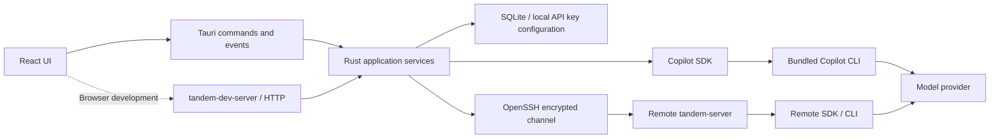

# From a message to project work

Users configure a provider, then choose chat or project work. Both share history, model selection, and streaming display. The difference is runtime configuration: chat receives only web tools; work receives the selected directory and file/command tools, with per-session approval or full access.

After a conversation starts, users can still change its model or provider beside the composer. The next message uses the new selection and continues the existing history. Switching and sending share a session lock. Switching is rejected while running or waiting for approval; once the selection is saved, the old connection is invalidated and cleaned up, then the same SDK session ID resumes with the new configuration. The UI displays the selection only after service confirmation and offers reconfirmation after connection failures, keeping the displayed model consistent with actual inference.

## Responsibilities and dependencies

`tandem-core` stores projects, provider configuration, sessions, and messages, manages active sessions, and converts runtime events into UI events. It does not depend on Tauri, so desktop and browser development modes call the same service.

`copilot-runtime` adapts only the official SDK. The SDK handles model requests, tool execution, context compaction, and session recovery. The application owns tool allowlists, permission requests, provider mapping, and telemetry parameters; it does not maintain a second agent loop.

`tandem-remote` owns system SSH, platform detection, atomic deployment, and bidirectional JSON RPC with request IDs. The remote `tandem-server --stdio` accepts only agent lifecycle commands and runs work through `copilot-runtime`. Provider keys pass through the SSH channel in memory; they are not written to remote preference files or process arguments.

`tandem-dev-server` forwards local development HTTP requests to `tandem-core`. The production desktop calls `tandem-core` directly through Tauri without an HTTP host. Remote execution needs neither project management, SQLite, nor system credential stores. The development host and remote agent therefore have separate binary entry points.

`tandem-protocol` contains shared RPC frames, serialization, size limits, and error types. It depends only on Serde, JSON, Tokio, and error support, with no application service, SSH client, or SDK dependency. Sharing the protocol cannot pull local application features into the remote agent.

| Module              | Allowed workspace dependencies       | Responsibility boundary                                                                     |
| ------------------- | ------------------------------------ | ------------------------------------------------------------------------------------------- |
| `tandem-desktop`    | `tandem-core`                        | Tauri windows, native directory selection, and command/event bridging                       |
| `tandem-core`       | `copilot-runtime`, `tandem-remote`   | Application rules, history, and credentials; no window or HTTP framework                    |
| `copilot-runtime`   | None                                 | SDK sessions, permission boundaries, and telemetry adaptation                               |
| `tandem-remote`     | `tandem-protocol`                    | SSH client, remote deployment, and transport                                                |
| `tandem-protocol`   | None                                 | Shared RPC format and frame I/O                                                             |
| `tandem-server`     | `copilot-runtime`, `tandem-protocol` | Remote agent; no `tandem-core`, `tandem-remote`, Axum, SQLite, or credential store          |
| `tandem-dev-server` | `tandem-core`                        | Local HTTP development entry point; excluded from remote and desktop distribution resources |

The application command entry point only dispatches requests and serializes results. Providers, projects, and sessions each own validation, concurrency rules, and persistence. `AgentHandle` contains the differences between local and remote agents; conversion from events to UI history is maintained separately. Session states and message roles use enums while retaining the existing JSON strings externally.

A pure reducer centralizes frontend session state changes; subscriptions and requests remain in hooks. Form submission rules are separate from components, so history merging, late events, and key retention/deletion can be tested without starting the desktop. Both SSH endpoints share framing and size limits. Connection tests inject I/O to cover broken streams and write failures directly.

## Typed failures

When an operation fails, users receive an actionable message and can retry after correcting the indicated settings or session state. Rust services return domain-specific `thiserror` enums: validation, persistence, API key storage, runtime configuration, title inference, SSH, and RPC framing each preserve distinct failure reasons. `tandem-core::Error` composes these errors and enumerates application conflicts such as changing a running conversation's model. Callers match variants rather than inspecting message text. Underlying I/O, SQLite, JSON, and SDK causes remain available through error sources where they do not expose private input; sensitive parse errors retain only their category and location, and title inference retains only a safe failure variant.

Desktop IPC and development HTTP serialize command failures as `{code, error}`. The code is one of `invalid_input`, `not_found`, `conflict`, `unavailable`, or `internal`; HTTP maps these to 400, 404, 409, 503, and 500 respectively. The frontend retains both fields in `CommandError`. SSH RPC failure envelopes carry `{id, error: {code, message}}`, with `RpcErrorCode` distinguishing invalid payloads, missing approvals, disconnected sessions, busy runtimes, timeouts, and other remote failures. The SSH client preserves that code until the application boundary maps it to the corresponding command category. Display messages may change without changing recovery logic.

## Interface language

The application defaults to English, independently of the operating system language. Users can switch to Simplified Chinese in **Settings > General > Language**. The selection applies immediately and is saved under `tandem.locale` in the local browser/webview storage; only the language preference is stored there. Startup applies that preference before rendering the interface.

`src/i18n/` owns the locale registry and typed message catalogs. Components select messages by stable keys rather than embedding translated copy. English defines the message shape, and other catalogs must provide the same keys and compatible message parameters. Use the active locale when introducing user-facing date or number formatting. Adding a language requires a catalog and a locale registry entry; it does not require changing component behavior. Untouched session-title placeholders use the selected language, identified by existing `titleState: "pending"` metadata; generated and manually saved titles retain their original values. User content, model IDs, paths, and backend diagnostic details also retain their original values.

## Chat boundaries

The runtime uses the SDK's bare configuration mode, disabling environment plugins, skills, file hooks, and automatic configuration discovery. Chat exposes only `builtin:web_fetch` to the model. All SDK tool permission requests are approved automatically, without creating pending approvals or confirmation dialogs. The tool allowlist restricts available capabilities, and the chat prompt explicitly asks the agent to call tools directly.

This controls agent tool capabilities. The CLI still needs to save sessions, logs, and runtime state in the application's private directory; the application does not claim to provide an operating-system sandbox. Work is also not a directory sandbox, and commands can access content outside the project directory.

## Work permission modes

Each work session stores `permissionMode`, either `ask` or `allow-all`. New work sessions default to asking each time. Ask mode shows each SDK permission request as an approval card; full access approves automatically without pending approvals. Chat always approves tool permission requests automatically, ignores this field, and offers no permission switch.

Both local and remote session creation/recovery receive the permission mode again. Changes are allowed only when no task is active; the service rejects switches while running or waiting for approval. Switching disconnects the existing agent. The next explicit send resumes the same session with the new mode, preserving history without replaying tasks. The frontend also blocks sending while a switch is pending so concurrent requests cannot use an unexpected mode.

If the save response is lost, the UI reads the actual permission mode from the service. If that read fails, it displays a pending confirmation state, keeps sending and switching disabled, and offers **Confirm permissions again**. Actions resume only after confirmation, preventing the UI from showing an old mode while the runtime has already adopted a new one.

Bare configuration removes the SDK's default environment context. Work prompts therefore include the normalized project path explicitly and require file tools to use absolute paths based on it. The SDK session configuration still provides the shell working directory. Chat prompts contain no host directory.

## History and API keys

SQLite stores user-visible history and configuration; Copilot's own session state lives in a private application runtime directory. Tandem resumes SDK sessions with the same UUID and reapplies provider, tool, and permission configuration. Deleting a project deletes its conversations. A provider's associated conversations must be handled before the provider can be deleted.

API keys are stored in plaintext in the application's local SQLite database, named `tandem.sqlite3`. The separate `provider_secrets` table keeps keys out of conversation messages. Omitting `apiKey` in settings requests preserves the existing value; an explicit empty string clears it. Ordinary snapshots return only `hasApiKey`. The provider editor reads the actual value on demand through `get_provider_api_key`, displays a password field by default, and lets users reveal it. Keys are never written to browser persistent storage, logs, or command-line arguments.

The desktop and development host use the same local storage implementation without system credential stores. A development host started with `--data-dir` uses independent storage in that directory. `--ephemeral-secrets` explicitly enables an in-memory store for tests only; credentials disappear when the process exits.

The desktop application identifier is `app.tandem.desktop`, which selects its application data directory. The development host uses its configured data directory. Both store the database as `tandem.sqlite3` and SDK session state in its `runtime/` subdirectory.

The remote executable is deployed to `~/.local/share/tandem/bin/tandem-server`. Remote SDK state uses `~/.local/share/tandem/runtime`.

## Automatic titles

After the first completed reply, `tandem-core` asks a model to summarize the title in the background. The title model is stored independently in preferences and can be any configured provider model; without an explicit selection, it follows the session's model. Changing title settings does not restart active chat or work. Users can request another title through **Regenerate title** in the conversation options menu.

Summarization receives only bounded user text and the assistant's final reply from the first complete turn. It skips interrupted replies and pre-tool introductions, and explicitly marks the content as data to summarize. `copilot-runtime` creates a separate temporary session with all tools, permissions, and configuration discovery disabled, while retaining the provider's model and token parameters. Completion, failure, or cancellation triggers time-bounded cleanup. Title replies never enter the user's chat history. Titles for both local and SSH work are generated locally, so the remote protocol does not need settings or history management.

Title tasks limit concurrency and wait time. Failure displays only a retryable title error without changing the main session state. Manual naming, deleting sessions or projects, and updating model configuration invalidate stale results. Successful titles are persisted and update the list and active session through a separate event. Snapshots include sessions with title generation in progress so reconnecting can restore the UI state.

## Events and interruption

SDK text fragments stream to the UI. Once a complete reply is persisted, it replaces the temporary bubble. The service retains the current turn's fragments and pending approvals so a refreshed UI can recover them from a snapshot. Stopping or abnormal interruption saves received fragments as an interrupted message. Permission requests have single-use request IDs; stopping a session rejects unanswered requests. Process shutdown disconnects sessions before stopping the CLI so telemetry can flush.

Every send requires a caller-supplied message UUID, and the service saves the user message with that ID. Live confirmation and loaded history use the same identity to replace temporary bubbles, even when confirmation events are lost. Separate sends with identical text remain distinct. The database rejects repeated submissions with the same ID before the task executes again.

Each session serializes its own send and stop operations; SSH initialization does not block other sessions. After detecting runtime exit, the next user send rebuilds the runtime and resumes the session without automatically resending submitted tasks.

Stopping waits both for SDK generation to end and for the application to finish processing completion events and saving history. The next send uses the same completion barrier so trailing events from the previous turn cannot overwrite new state. Reconnecting or deleting a session cancels and awaits the old event forwarding task. Canceling a permission callback also removes its pending approval.

Error events invalidate the active connection and stop forwarding; the next explicit send resumes the session. This does not depend on whether the SDK sends `idle` after an error, and late events from the old connection cannot affect the next turn.

`tandem-dev-server` binds only to loopback and validates Host, Origin, and cross-site requests. Production desktop bundles use Tauri IPC and neither run nor distribute this HTTP entry point. The UI receives only local window events and the system capabilities needed for user-initiated directory selection.
