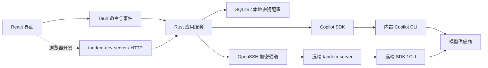

# 从一条消息到一次项目工作

用户先配置供应商，再选择聊天或项目工作。两种会话共享历史、模型选择和流式显示；差别发生在运行时配置：聊天只拿到网页工具，工作拿到指定目录和文件、命令工具，并按会话选择逐次询问或完全授权。

对话开始后仍可从输入框旁切换模型或供应商，下一条消息使用新选择并继续原历史。切换与发送共享会话锁；运行中和等待审批时拒绝切换，旧连接在选择保存后失效并清理，随后以同一 SDK 会话 ID 和新配置恢复。界面等待服务确认后才显示新选择，连接异常时可重新确认，避免显示的模型与实际推理配置不一致。

## 哪一层负责什么

`tandem-core` 保存项目、供应商配置、会话和消息，管理运行中的会话，并将运行时事件转换为界面事件。它不依赖 Tauri，因此桌面与浏览器开发模式调用同一个服务。

`copilot-runtime` 只适配官方 SDK。模型调用、工具执行、上下文压缩和会话恢复由 SDK 处理。应用负责工具白名单、权限请求、供应商映射和遥测参数，不维护另一套 Agent 循环。

`tandem-remote` 负责系统 SSH、平台检测、原子部署和有请求 ID 的双向 JSON RPC。远端的 `tandem-server --stdio` 只接受 Agent 生命周期命令，调用 `copilot-runtime` 执行工作。供应商密钥通过 SSH 内存通道传递，不写入远端偏好文件，也不出现在进程参数中。

`tandem-dev-server` 将本机开发用的 HTTP 请求转给 `tandem-core`。正式桌面直接通过 Tauri 调用 `tandem-core`，不启动 HTTP 主机；远端也不需要项目管理、SQLite 或系统凭证库。开发主机与远端 Agent 因此使用独立的二进制入口。

两端的 RPC 帧、序列化、大小限制和错误类型集中在 `tandem-protocol`。它只依赖 Serde、JSON、Tokio 和错误类型支持，不依赖应用服务、SSH 客户端或 SDK，因此共享协议不会把本机功能带到远端。

| 模块                | 允许的 workspace 依赖                | 职责边界                                                                 |
| ------------------- | ------------------------------------ | ------------------------------------------------------------------------ |
| `tandem-desktop`    | `tandem-core`                        | Tauri 窗口、系统目录选择、命令与事件桥接                                 |
| `tandem-core`       | `copilot-runtime`、`tandem-remote`   | 应用业务、历史与凭证；不依赖窗口或 HTTP 框架                             |
| `copilot-runtime`   | 无                                   | SDK 会话、权限边界与遥测适配                                             |
| `tandem-remote`     | `tandem-protocol`                    | SSH 客户端、远端部署与传输                                               |
| `tandem-protocol`   | 无                                   | 两端共享的 RPC 格式与帧读写                                              |
| `tandem-server`     | `copilot-runtime`、`tandem-protocol` | 远端 Agent；不依赖 `tandem-core`、`tandem-remote`、Axum、SQLite 或凭证库 |
| `tandem-dev-server` | `tandem-core`                        | 本机 HTTP 开发入口；不进入远端或桌面分发资源                             |

应用命令入口只分发请求和序列化结果。供应商、项目和会话各自负责校验、并发约束与持久化；本地和远端 Agent 的差异集中在 `AgentHandle`，事件到界面历史的转换单独维护。会话状态和消息角色使用枚举，对外仍发送原有 JSON 字符串。

前端的会话状态由纯 reducer 统一转换，订阅与请求留在 hook 中。表单提交规则也与组件分开，因此历史合并、迟到事件、密钥保留或删除等行为无需启动桌面即可测试。SSH 两端共用帧协议与大小限制，连接测试可以注入输入输出，直接覆盖断流和写入失败。

## 聊天的边界

运行时采用 SDK 的空配置模式，关闭环境中的插件、技能、文件钩子和自动配置发现。聊天只向模型提供 `builtin:web_fetch`；所有 SDK 工具权限请求均自动批准，不创建待审批项，也不弹出确认。工具白名单负责限制可用能力，聊天提示明确要求直接调用工具。

这控制的是 Agent 工具能力。CLI 自身仍需要在应用私有目录保存会话、日志和运行状态；应用没有宣称这是操作系统级沙箱。工作同样不是目录沙箱，命令可能访问项目目录以外的内容。

## 工作的权限模式

每个工作会话保存 `permissionMode`，值为 `ask` 或 `allow-all`。旧工作会话与省略该字段的新工作会话都默认逐次询问。逐次询问将每个 SDK 权限请求展示为审批卡；完全授权由运行时自动批准，不创建待审批项。聊天始终自动批准工具权限请求，不受这个字段影响，也不提供权限切换。

创建和恢复本地、远端会话时都重新传入权限模式。更改模式只允许在会话没有运行中的任务时进行，服务端拒绝运行中或等待审批时的切换。切换后断开现有 Agent，下一次主动发送恢复同一会话并应用新模式，保留消息历史且不重放旧任务。前端也锁住切换期间的发送，防止并发请求采用意外的权限模式。

如果保存响应丢失，界面会重新读取服务端实际权限。读取失败时显示「待确认」，保持发送与切换禁用，并提供「重新确认权限」；确认成功才恢复操作，避免界面显示旧模式而运行时已经采用新模式。

空配置模式会移除 SDK 的默认环境上下文，因此工作提示显式提供规范化项目路径，并要求文件工具使用基于该目录的绝对路径。shell 的工作目录仍由 SDK 会话配置传入。聊天提示不包含宿主目录。

## 历史和密钥

SQLite 存放用户可见历史与配置，Copilot 自己的会话状态保存在应用私有运行时目录。应用使用同一个 UUID 恢复 SDK 会话，并重新应用供应商、工具和权限配置。删除项目会删除关联对话，删除供应商前必须先处理其关联对话。

API Key 明文保存在应用数据目录的 SQLite 数据库中，新安装使用 `tandem.sqlite3`；独立的 `provider_secrets` 表保存密钥，不混入对话消息。设置接口省略 `apiKey` 表示保留原值，显式空字符串表示清除。普通快照只返回 `hasApiKey`；供应商编辑页通过 `get_provider_api_key` 按需读取实际值，默认显示为密码输入框，用户可切换显示。密钥不写入浏览器持久存储、日志或命令行参数。

桌面和开发主机使用同一套本地存储，不依赖系统凭证库，也不迁移旧版密钥。开发主机指定 `--data-dir` 时使用该目录的独立本地存储。`--ephemeral-secrets` 显式启用仅供测试的内存存储，凭证随进程结束而消失。

应用标识为 `app.tandem.desktop`。升级时，新应用目录若已有数据库则优先使用；否则旧 `app.relay.desktop` 目录中存在数据库时，继续原地使用整个旧目录，包括数据库、WAL 和 SDK 运行状态。指定 `--data-dir` 的开发主机也能读取原有 `relay.sqlite3`；同一目录中以 `tandem.sqlite3` 优先。此兼容仅选择已有存储，不复制、移动或合并数据，也不读取系统钥匙串。

远端程序部署到 `~/.local/share/tandem/bin/tandem-server`，仅探测和复用此名称的程序。远端 SDK 状态使用 `~/.local/share/tandem/runtime`；只有新目录不存在时，才回退到已有的 `~/.local/share/relay/runtime`。路径检查失败会报告错误，避免把无法读取的旧状态误判为没有历史。

## 自动标题

首轮回复完成后，`tandem-core` 在后台请求模型总结标题。标题模型独立保存在偏好设置中，可选择任意已配置的供应商模型；未指定时使用该会话的模型。更改标题设置不重启当前聊天或工作。旧会话保持原名，用户可主动重新生成。

总结只传入首个完整轮次中长度受限的用户消息和助手最终回复，跳过中断回复和工具前的开场说明，并明确将内容标为待总结的数据。`copilot-runtime` 为此创建独立临时会话，关闭所有工具、权限与配置发现，保留供应商的模型和 token 参数。结束、失败或取消后限时清理临时会话，标题回复不会进入用户的聊天历史。本地和 SSH 工作均在本机执行标题总结，远端协议无需承担设置或历史管理。

标题任务限制并发和等待时间；失败仅显示可重试的标题错误，不改变主会话状态。手动命名、删除会话或项目、更新模型配置会使对应的旧结果失效。标题成功后持久化，并通过独立事件更新列表和当前会话标题；快照包含正在生成标题的会话，支持重新连接后恢复界面状态。

## 事件与中断

SDK 的文本片段实时送到界面，完整回复持久化后替换临时气泡。服务保留当前轮的片段与待审批请求，界面刷新后可从快照恢复；停止或异常中断会将已收到的片段保存为中断消息。权限请求具有一次性的请求 ID；停止会话会拒绝尚未回答的请求。进程退出时先断开会话，再停止 CLI，以便刷新遥测。

发送时由界面生成消息 UUID，服务沿用这个 ID 保存用户消息。实时确认与历史加载使用同一身份替换临时气泡，确认事件丢失后也能正确合并；相同文字的不同发送保持独立。旧调用可以省略消息 ID，由服务生成。

各会话分别串行处理发送与停止，SSH 初始化不会占住其他会话。发现运行时退出后，下一次用户发送会重建运行时并恢复会话，不自动重发已提交的任务。

停止操作既等待 SDK 结束生成，也等待应用处理完结束事件并保存历史。下一轮发送沿用这个完成条件，防止上一轮的尾部事件覆盖新状态。重连或删除会话前，会取消并等待旧事件转发任务退出；权限回调被取消时也会移除对应的待审批项。

错误事件会同时使当前连接失效并停止转发，下次显式发送时恢复会话。这样不依赖 SDK 是否在错误后继续发送 `idle`，旧连接的尾部事件不会影响下一轮。

`tandem-dev-server` 只绑定回环地址，并校验 Host、Origin 和跨站请求。正式桌面包使用 Tauri IPC，不运行或分发这个 HTTP 入口。界面只获得本地窗口事件和用户主动选择目录所需的系统能力。
