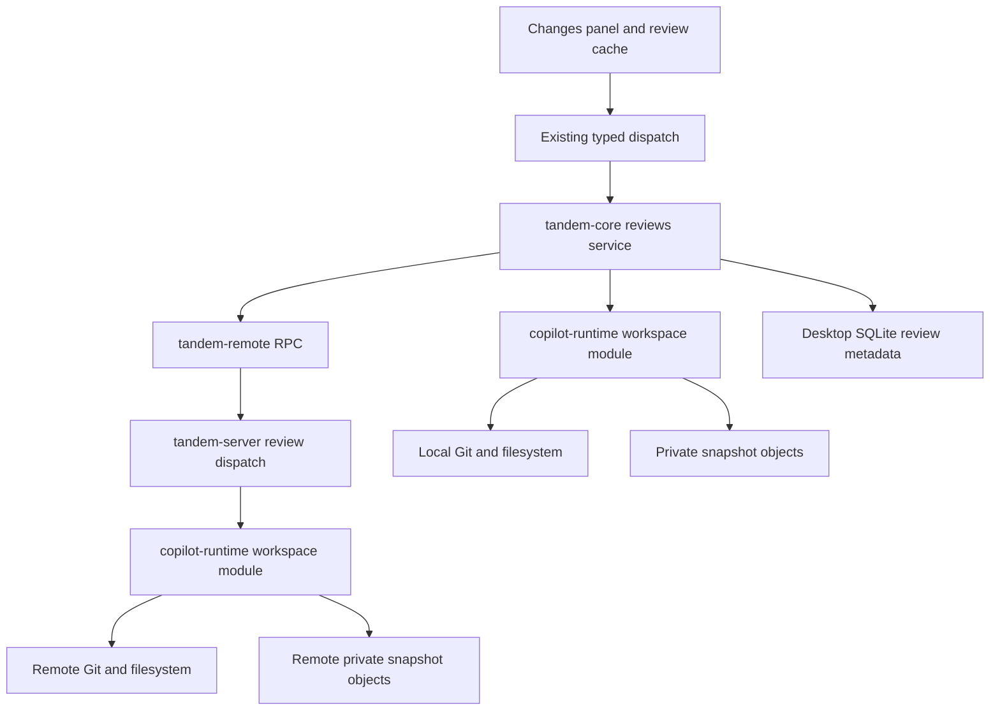

# Work session change review

Status: Design baseline for the implemented read-only Work review. Research date: 2026-10-22. Repository baseline: `ff6adf729d1e72efc6673f6f300b4f968fc13e2d` (`main`).

## Implementation decisions

The initial implementation includes workspace, session, and individual-turn review for local and SSH projects. It uses the existing React/CSS stack to render structured hunks without a new dependency: the required Context7 query was unavailable because its service quota was exceeded. Unified and side-by-side views, line wrapping, file filtering, pagination, and explicit partial/unavailable states are implemented. Each file response is bounded; oversized diffs show a placeholder instead of providing arbitrary extra context or hunk pagination.

The architecture and user-facing behavior are described in [Architecture](architecture.md#work-change-review) and [User guide](user-guide.md#review-code-changes). The sections below preserve the research and engineering rationale, including recommendations beyond the initial implementation. Automatic retention/garbage collection, background prefetch of every remote historical file, overlap detection beyond the persistent attribution notice, inline feedback, editing, Git write actions, and isolated execution worktrees remain follow-ups. Captured objects are deduplicated and individually bounded; retained project history is not automatically evicted. Only already retrieved remote detail is guaranteed to remain readable offline. Executed checks and their limits belong in the pull request, following the [Verification guide](verification.md).

## User experience and recommendation

A user opens a Work conversation, selects **Changes** in its header, browses every detected changed file, and reads its diff beside the conversation. The header shows file count, additions/deletions when known, review scope, and freshness. A completed turn offers a shortcut to its captured changes. The same experience applies to local and SSH projects.

Build a read-only review service in Rust and reuse the existing right detail panel. Use filesystem content and Git state as evidence; SDK tool events only invalidate caches and provide optional provenance hints. First deliver workspace review, then add immutable session and turn snapshots. Session/turn review is necessary to satisfy the stronger requirement of understanding changes produced during an agent task, including changes the agent commits.

Keep these scopes distinct:

| UI scope            | Comparison                                                                            | Meaning                                                                |
| ------------------- | ------------------------------------------------------------------------------------- | ---------------------------------------------------------------------- |
| Workspace           | Current HEAD/index/working tree                                                       | Current repository changes from any source; includes untracked files   |
| Since session start | Actual files immediately before the first submitted task to the latest captured state | Net changes during the session, excluding unchanged pre-existing edits |
| This turn           | Actual files before one user submission to its frozen end state                       | Changes during that submission, including edits later committed        |

Snapshots establish changes over time, not authorship. Multiple Tandem sessions, editors, formatters, and background processes can modify the same directory. Label this limitation persistently for session scopes; additionally flag known overlapping Tandem sessions. Independent worktrees are a future isolation feature, not a prerequisite for viewing diffs or a guarantee against every external writer.

The first supported scope is the selected project directory within its enclosing Git worktree. Show that root clearly. Changes outside it are outside review coverage even though Work tools have full access. Do not silently expand a subdirectory project to the entire repository. Ignored files and nested repositories have explicit coverage limits.

## Product research

| Product             | Verified official behavior                                                                                                                                                                 | Application to Tandem                                                                                                                                                                                     |
| ------------------- | ------------------------------------------------------------------------------------------------------------------------------------------------------------------------------------------ | --------------------------------------------------------------------------------------------------------------------------------------------------------------------------------------------------------- |
| Codex app           | Review reflects repository state, including edits from the user and other sources. It offers unstaged, staged, commit, branch, and last-turn scopes, plus inline feedback and Git actions. | Separate scope from attribution; provide a persistent review panel. [Official review documentation](https://learn.chatgpt.com/docs/code-review?surface=app)                                               |
| Claude Code Desktop | Changes and line-count controls open file diffs; users can attach line comments and submit feedback to the agent. Worktree execution is available.                                         | Put review beside the conversation and later connect selected lines to follow-up requests. [Desktop documentation](https://code.claude.com/docs/en/desktop#review-changes-with-diff-view)                 |
| Cursor              | Its Agents Window includes a diff view and worktree workflows. Checkpoints are local and separate from Git.                                                                                | Keep code review, checkpoint history, and Git state as separate concepts. [Agents Window](https://cursor.com/docs/agent/agents-window), [checkpoints](https://cursor.com/docs/agent/overview#checkpoints) |
| Cascade             | Named checkpoints and restoration to previous steps are documented; the former Windsurf documentation currently redirects to Devin Desktop/Cascade.                                        | Restoration is a separate operation requiring its own correctness model. [Cascade documentation](https://docs.devin.ai/desktop/cascade/cascade#named-checkpoints-and-reverts)                             |

Claude explicitly documents that checkpoint tracking does not cover Bash edits and has limits around other sessions and subagents. This is evidence against reconstructing complete changes from edit-tool payloads alone. [Checkpoint limitations](https://code.claude.com/docs/en/checkpointing#limitations)

These references establish product behavior, not those products' internal architecture. Tandem's design below is an engineering recommendation based on its own source.

## Current architecture

| Existing implementation                                                                            | Design consequence                                                                                  |
| -------------------------------------------------------------------------------------------------- | --------------------------------------------------------------------------------------------------- |
| `src/lib/detailPanel.ts`: identity-based selection, currently `subagent` only                      | Add a `changes` variant without storing copied diff content in panel selection                      |
| `src/components/DetailPanel.tsx` and CSS: resizing, focus restoration, Escape, narrow-screen modal | Reuse the shell; choose unified/split layout using panel width                                      |
| `src/App.tsx`: Work header and detail-panel renderer                                               | Add the Changes entry and select the appropriate panel renderer                                     |
| `src/lib/types.ts`, `src/lib/api.ts`, `crates/tandem-core/src/dispatch.rs`                         | Extend the existing typed command dispatch; both Tauri and development HTTP use it                  |
| `src/lib/api.ts`: explicit SSE event list                                                          | Register new review events here as well as in the TypeScript union                                  |
| `crates/tandem-core/src/projects.rs`: projects validate directories, not Git repositories          | Missing Git or a non-Git directory must disable review gracefully without disabling Work            |
| `crates/tandem-core/src/sessions.rs`: per-session submission locks and prepare/send separation     | User message UUID is a suitable application turn identity; there is no project-wide write isolation |
| `crates/copilot-runtime/src/events.rs`: tool/lifecycle events                                      | Useful refresh triggers; there is no authoritative file-change record                               |
| `crates/copilot-runtime/src/permissions.rs`: approval preview and AllowAll bypass                  | Approval diffs cannot serve as change history                                                       |
| `crates/tandem-core/src/agent.rs`: local/remote handles and synchronous completion processing      | Reuse location abstraction; keep filesystem scans out of synchronous event locks                    |
| `crates/tandem-protocol/src/lib.rs`: shared RPC frames, 32 MiB frame ceiling                       | Use paged lists and bounded per-file responses far below the ceiling                                |
| `scripts/check_workspace.py`: explicit dependency allowlist                                        | A new server dependency on a shared workspace crate is not allowed under current rules              |

## Ownership and data flow

- **`copilot-runtime::workspace`** owns bounded Git execution, repository discovery, file enumeration, content capture, diff generation, private snapshot objects, and typed inspection failures. It is callable without starting the SDK or making inference requests.
- **`tandem-core::reviews`** owns Work/session eligibility, project resolution, review scopes, session/turn associations, persistence policy, desktop cache, and UI events. A location-aware `WorkspaceHandle` follows the existing `AgentHandle` pattern without requiring a live agent.
- **`tandem-server`** parses requests, checks connection/workspace ownership, calls workspace operations, and maps errors. It contains no duplicate Git business rules or SQLite.
- **`tandem-protocol`** owns stable wire error codes and framing. Public workspace DTOs can live in `copilot-runtime`, with core using them locally and deserializing remote JSON through `tandem-remote`; do not add runtime-to-protocol or core-to-protocol dependencies.
- **React** owns navigation, presentation, request cancellation, and stale-response rejection. It neither scans files nor determines the authoritative comparison.

This deliberately broadens `copilot-runtime` from its current SDK-only responsibility to SDK integration plus execution-host workspace inspection. Update its module documentation and `docs/architecture.md` when implementing. It preserves the existing dependency graph. Extracting a separate `tandem-workspace` crate would require an explicit future change to the project rules and boundary checks; it is not part of this proposal.

## Workspace inspection

Use the installed Git executable initially. This preserves familiar Git behavior without introducing libgit2 or gix and their separate compatibility surface. Detect Git on the execution host and return actionable availability information. Do not install Git or initialize a repository automatically.

Repository discovery resolves both the worktree root and selected project prefix, including linked worktrees and unborn HEAD. Calls use argument arrays, explicit working directories, literal path handling, bounded output, deadlines, and cancellation. Paths never enter a composed shell command. Avoid optional index refresh locks and disable external diff/text conversion helpers and configured fsmonitor hooks. A read-only design must also account for repository clean/process filters: `--no-textconv` does not disable all Git filters. Prefer captured raw bytes for inspection, or reject an unsupported filter configuration rather than silently running its program. Missing base objects in partial clones must not trigger implicit network fetches or credential prompts: verify and use the installed Git's no-lazy-fetch control, or return an unavailable-object result.

Use `status --porcelain=v2 -z --untracked-files=all` for structured inventory. Preserve both index and working-tree status. Read staged, unstaged, and HEAD-to-working-tree comparisons as separate views; enumerate new files explicitly. Do not concatenate staged and unstaged patches into a supposed net diff. For example, HEAD `A`, index `B`, and working file `A` has two pending changes but an empty net diff. The file must remain discoverable with both states. [Git status](https://git-scm.com/docs/git-status), [Git diff](https://git-scm.com/docs/git-diff)

For the default Workspace view, offer **Net**, **Staged**, and **Unstaged** comparisons for files where relevant. Inventory is their union, plus untracked/conflicted entries. Counts describe the selected comparison; an index-only difference with no net content change is explicit, not omitted. Do not add counts from opposing comparisons. A committed change disappears from Workspace but remains in a captured turn.

The service freezes the compared bytes or objects behind a review revision. A file read must use those bytes, not whatever is on disk when the user clicks later. For on-demand workspace capture, inspect before/after fingerprints and index/HEAD identity; retry boundedly or reject the revision if it changed. Avoid claiming a globally atomic snapshot of a live filesystem.

## Session and turn snapshots

### Content model

Capture **actual working-tree bytes**, file existence, type, and mode. A HEAD SHA alone loses dirty files, existing untracked files, and line-ending differences. Initial implementation should favor a correct bounded capture over an unproven dirty-file optimization.

Enumerate tracked files and non-ignored untracked files under the selected directory. Use the union of before/after manifests to detect deletions. Keep already-captured paths eligible if ignore rules later change; otherwise a new ignore rule could conceal an edit. Read symlink targets as link data without following them. Treat submodules and nested repositories as separate entries with explicit unsupported-recursion status. Unknown or excluded paths cannot be advertised as fully reviewed.

Use a manifest of path identity to immutable content hash/object, size, type, mode, and capture status. Store objects outside the project and deduplicate them by content. Never use hidden `git add`, commits, refs, stash, or changes to the user's index for bookkeeping. Hashing/copying must preserve raw bytes and not invoke repository filters. Comparing private captured files with Git's `--no-index` is one implementation option; exit code 1 means a difference. [Git hash-object](https://git-scm.com/docs/git-hash-object), [Git diff](https://git-scm.com/docs/git-diff)

Raw snapshots and Git presentation have distinct line-ending semantics. Retain exact bytes and hashes; a presentation option may normalize CRLF for display, but it must expose EOL-only changes and never rewrite the stored evidence. Git-normalized and raw-session counts need not match and should be labeled accordingly.

### Lifecycle

1. Prepare the submission and reserve its existing session send slot. Associate review with the caller's message UUID, independently of SDK internal turn IDs.
2. Immediately before submission, capture `before`. Bind `sessionStart` to the first submitted task's baseline, including an explicit missing/partial result if capture fails. Never substitute a later successful baseline and label it the session start. A later tracking anchor requires a distinct label, such as Since tracking began. Include existing dirty/new files. Cancelled preparation must not create a completed review or bind the session start.
3. While running, tool completion/failure and coarse polling invalidate live workspace review. A tool success flag does not prove that a failed operation made no edits.
4. On observed idle or confirmed termination, atomically register a bounded final-capture barrier before another submission may begin. A Stop request alone is not evidence of termination. Freeze `after`, then release that barrier. If failure or disconnection prevents observing termination, retain partial evidence rather than claiming a final endpoint. Compute patches and transfer/cache them asynchronously afterward.
5. Make repeated terminal events idempotent by message UUID and connection generation. Review failure produces a review status, not `EventKind::Error`, which currently fails the agent connection.

The current runtime releases its turn lifecycle while forwarding a terminal event. Add a separate review-capture barrier that the next prepare/send waits on. Its coordinator must outlive a disposable live AgentSession or transport: rebuilding a connection after an error must not bypass an old capture. Register it before releasing the lifecycle. Do not run disk scans inside core's synchronous `TurnCompletion::process_event`, and do not make abort await a capture job that itself awaits abort. The coordinator performs capture with cancellation/deadline support while the event reader and control RPC capacity remain responsive.

On capture timeout or unavailable storage, cancel and await readers, or seal an immutable partial manifest and revoke the capture generation's ability to publish further content, before releasing the barrier. Reject late results so next-turn bytes cannot enter the old endpoint. Settle the review as `partial` or `unavailable` and allow Work to continue. This is a loss of review coverage, not an agent execution failure. After a crash or lost SSH connection, preserve the last durable evidence; a fresh scan after reconnect is a later recovery observation, not a fabricated end-of-turn snapshot.

Session scope compares the first baseline with the latest captured endpoint. It can include external changes between turns. Turn scope compares its own two endpoints and does not concatenate earlier patches. A file changed and restored within a turn has no final net diff; tracking every transient edit would be a separate audit-log feature.

### Persistence and SSH

Desktop SQLite stores review IDs, session/message associations, scope, endpoint IDs, revisions, timestamps, coverage, and completion state in explicit new tables. Large content lives in private object files, outside ordinary application snapshots, messages, and browser storage. Write objects first, then atomically publish a manifest, then commit metadata; recovery can collect orphaned objects. No compatibility aliases or migration layer is proposed.

The remote host stores objects/manifests in a private directory independent of the versioned daemon socket. It never gains SQLite. The desktop caches received final patches/content under the same identities. Transfer final artifacts in bounded background requests; show cache completeness. Offline review is guaranteed only for cached content, and an uncached file reports that the remote host is needed. Reopening a completed review must not make a model request.

Opening review reuses an existing transport or connects to an already installed compatible server with a workspace-only binding. It does not create an SDK session or silently bootstrap a fresh host. If the host is unprepared, explain that review becomes available after normal Work preparation; cached historical results remain accessible. New workspace bindings are scoped to a connection and to the project path resolved by core; later calls use opaque IDs rather than arbitrary client paths.

Protect active session baselines and in-flight captures from eviction. Define bounded history/cache retention and expose `expired` for intentionally removed content. Session deletion releases only its owned references. Remote cleanup is bounded and may finish on a later connection. No operation recursively deletes a user project.

## Commands, events, and consistency

Proposed application commands, through the existing generic dispatch. Review selection is a tagged union: `workspace { comparison: net | staged | unstaged }`, `session`, or `turn { messageId }`. Comparison is part of the review identity; turn selection requires its message ID rather than permitting unrelated optional fields.

| Command              | Inputs                                                     | Result                                                                                               |
| -------------------- | ---------------------------------------------------------- | ---------------------------------------------------------------------------------------------------- |
| `get_review_summary` | session ID, tagged review selection                        | Availability, comparison description, immutable revision, timestamps, counts, coverage, cache status |
| `list_review_files`  | review ID, revision, cursor                                | Bounded file metadata page and next cursor                                                           |
| `get_review_file`    | review ID, revision, file ID, optional hunk/context cursor | Patch/hunks or explicit non-text/oversize reason                                                     |
| `refresh_review`     | session ID, live review selection                          | Starts or joins a deduplicated refresh; frozen history is not overwritten                            |

Review records include `workspaceId`, `reviewId`, `revision`, tagged selection, baseline/endpoint identifiers, `capturedAt`, availability, refresh state, and coverage. File records include opaque `fileId`, old/new display paths, old/new modes, index/worktree status, content kind, counts, and completeness. Counts can be unknown while scanning or for binary files; unknown is not zero. Keep availability, refreshing/stale state, and partial coverage as independent dimensions.

Patch pagination preserves whole hunks, with file identity, comparison, and revision on every page. A renderer adapter assembles these pages into one file model; it must not send arbitrary transport fragments to a patch parser. A single hunk above the response limit has an explicit oversize result. Loading more context reads the same captured endpoint, never the live file.

Emit lightweight `review_updated` or `review_invalidated` events through existing IPC/SSE. Do not broadcast source text with every token or put patches in the global application snapshot. Extend the frontend event union and SSE allowlist together. Extend stable RPC error codes and bump the remote protocol contract so incompatible servers use the existing replacement path, with no legacy fallback.

Key frontend caches by workspace, session where relevant, full tagged selection including comparison/message ID, review revision, and file. Reject responses from a previous navigation/request generation. Never combine an old patch with a new file-list revision. `RevisionExpired` triggers a fresh summary; frozen review IDs never silently resolve to current files. Preserve a selected file and reading position where possible.

Use typed `thiserror` domain variants such as `GitUnavailable`, `NotRepository`, `WorkspaceUnavailable`, `InvalidPath`, `ReviewNotFound`, `RevisionExpired`, `CaptureIncomplete`, `OutputLimitExceeded`, and `InspectionTimeout`, retaining structured context and underlying causes. Non-text files and coverage limits are usually typed result states rather than whole-review failures. Map codes at transport boundaries and localize user-facing messages in typed catalogs.

## UI and renderer

Add `ChangesDetailPanel`, a dedicated review hook/cache, and a `changes` selection variant in `detailPanel.ts`. Keep selection identity separate from review data. Extend the current renderer in `App.tsx`, including assumptions that every selected detail has an agent. Preserve existing panel close/focus behavior when switching between worker output and review.

Start with a file list/tree, path filter, status badges, counts, refresh, and a selected file's unified diff. Every detected file remains navigable; loading every body simultaneously is unnecessary. Use the panel's actual width for split mode. The existing shell defaults to 42% width and becomes modal below 1100 px; a desktop viewport alone does not imply enough room for two code columns. A later All files mode can use virtualization.

Prefer a dedicated read-only renderer, provisionally `@pierre/diffs`. Its official reference supports React patch rendering, unified/split presentation, annotations, and virtualization. A patch alone cannot expand arbitrary unchanged content: that needs versioned original/modified file data. Workers are documented as experimental, so they are optional. [Official Diffs reference](https://diffs.com/llms-full.txt)

Monaco is the alternative if Tandem intends to add an embedded editor: it exposes a configurable diff editor but requires model/worker lifecycle integration. [Monaco diff options](https://microsoft.github.io/monaco-editor/typedoc/interfaces/editor_editor_api.editor.IDiffEditorOptions.html)

No renderer dependency was added by this research; the selection remains provisional. Context7 tools were unavailable in this session. Before adoption, complete the repository's required Context7 `library` and `docs` steps and a small Tauri WebView prototype. Verify Windows WebView2 and macOS WebKit, selection/copy, accessibility, themes, virtual scrolling, bundle cost, and Vite worker packaging. The current CSP restricts scripts to self; bundle all runtime assets locally and avoid CDN, eval, or broad CSP exceptions. Assign exactly one scroll owner to the renderer/panel.

Keep loading, scanning, current, stale, partial, unavailable, expired, and empty states distinct. Last good content can remain visible during a failed refresh with a clear timestamp. No Git repository should show an explanation, not an empty diff that implies no changes. Chat and unsent drafts do not expose project review.

Do not use Accept/Reject language in this initial design: SDK tools already changed files. Later line feedback should create an editable composer draft containing revision, file, side, line range, and comment, and send only when the user submits it. Stage/unstage, discard, and revert need separate expected-content checks, ownership semantics, and recovery behavior.

## Performance, coverage, and boundaries

Initial budgets are proposed tuning values, not measured guarantees:

| Resource           | Initial policy                                                                                                             |
| ------------------ | -------------------------------------------------------------------------------------------------------------------------- |
| File metadata page | At most 200 entries and 256 KiB serialized                                                                                 |
| Text capture       | At most 2 MiB per file; larger files remain visible with a reason                                                          |
| File diff response | At most 512 KiB serialized, with bounded hunk/context continuation                                                         |
| Capture budget     | At most 256 MiB copied content per capture and a deadline; report exclusions/incompleteness                                |
| Concurrency        | One scan per canonical worktree on an execution host; deduplicate only matching capture generations; bounded workers       |
| Refresh            | Coalesce activity triggers; while visible/running, poll at a coarse interval such as 2 seconds; stop polling hidden panels |

Refresh on panel opening, focus, explicit refresh, terminal events, reconnection, and tool completion/failure. Polling covers external edits and missing tool events without immediately adding a watcher dependency. Scope caches by canonical worktree identity, not project ID alone: two projects or sessions may refer to the same directory. Notify all affected open sessions of workspace invalidation. Frozen turn reviews stay unchanged.

Deduplicate only matching workspace, project prefix, tagged selection, and capture generation/endpoints. A before/after capture must not reuse a polling scan started before its logical boundary, or another turn's capture. Give boundary captures priority over visible-panel polling while retaining bounded concurrency.

Bound stdout/stderr while reading, not only after process completion; terminate timed-out child processes safely. Review requests use ordinary RPC capacity and cannot consume stop/approval/disconnect reservations. Source content must not enter logs, telemetry, exception diagnostics, or browser storage. Render it as text rather than interpreted HTML.

Explicit cases include empty repositories, staged/unstaged overlap, untracked files, renames, deletes, mode-only changes, conflicts, binary files, LFS pointers, sparse checkouts, line endings, missing final newline, and non-UTF-8 content. Binary and oversized items have metadata placeholders. Conflicts show unmerged state rather than a misleading ordinary patch. Do not fetch LFS content or recurse submodules automatically.

Preserve byte-safe path identities on Unix and separate display names from operational IDs. Reject path traversal, absolute/drive/UNC injection, escaping links, and stale file IDs. Test spaces, newlines, Unicode, leading hyphens, case-only renames, Windows drive paths, and linked-worktree `.git` files. If safe inspection of a path or encoding is unsupported, expose that limitation explicitly.

Non-Git projects remain usable for Work. A later filesystem-only snapshot mode can reuse the object/manifest model, but requires its own enumeration and ignore policy. Do not automatically run Git init to make the review UI work.

## Delivery sequence and acceptance

| Stage | Deliverable                                                                   | Exit condition                                                                                               |
| ----- | ----------------------------------------------------------------------------- | ------------------------------------------------------------------------------------------------------------ |
| 0     | Renderer prototype and Git fixture contract                                   | Required dependency documentation verified; WebView rendering and comparison semantics demonstrated          |
| 1     | Rust workspace inspector, read-only binding/RPC, typed DTOs/errors            | Local and SSH return equivalent bounded results; index/refs/files remain unchanged                           |
| 2     | Work Changes panel, summary/detail loading, refresh, i18n                     | Users can inspect every detected supported file; stale/error/partial states remain truthful                  |
| 3     | Session/turn capture, persistence, barrier, historical/offline cache          | Dirty baselines, agent commits, restart, cancellation, and next-turn sequencing preserve correct comparisons |
| 4     | Inline feedback; separately designed Git write actions and worktree isolation | Revision-aware feedback and safe mutations have their own tests and user semantics                           |

Stages 1 and 2 provide the first useful workspace-review release. Stage 3 completes the planned session-level review capability; do not advertise stages 1 and 2 as agent-only changes. Non-Git capture, arbitrary nested-repository aggregation, full transient edit auditing, and AI-generated code-review findings are separate follow-ups.

Verification should use temporary real Git repositories for semantics, not mocked command output alone. Cover dirty starting content and pre-existing new files; staging cancellation; shell/formatter/Fleet edits; edits committed during a turn; edits restored before completion; mode/rename/conflict/binary/EOL cases; special paths; scanning races; process limits; configured filters/fsmonitor hooks; missing partial-clone objects; and immutable revision reads.

Use the existing real SSH/proxy/daemon integration harness with test inference services to verify ownership, bounded pagination, disconnects, unprepared-host behavior, no hidden SDK startup, and responsive stop commands during large review loads. For stage 3, exercise real Copilot SDK submission and completion with the project's test providers. Record test-service versus real-provider coverage explicitly; a real paid model is not needed to prove Git diff semantics.

Frontend checks must cover session/scope switching during a fetch, out-of-order revisions, list/detail mismatch, unavailable-versus-empty states, local/SSH parity, keyboard navigation, modal focus, resizing, and large lists. Verify English/Chinese catalogs and identical IPC/development HTTP/SSE behavior.

For implementation delivery, run `just check`, `just check-workspace`, `just build`, `just desktop-build`, and `just desktop-bundle`, plus affected integration suites. Update `docs/architecture.md` and `docs/user-guide.md`; update `docs/verification.md` when verification procedures change and record actual results in the pull request. Update installation documentation if Git becomes a documented review prerequisite. Check `.github/workflows/ci.yml` path filters and steps when adding verification scripts or build inputs. New runtime modules are already included by the server's recursive source identity calculation; preserve this property. PRs must pass Required checks before merge.

## Research validation and limits

This proposal was prepared by inspecting the UI, core services, runtime, SSH protocol/server, dependency rules, and official product/library documentation. A temporary real Git fixture on Windows (`git version 2.48.1.windows.1`) confirmed:

- HEAD `A`, staged `B`, working tree `A` produces `MM` status with an empty HEAD-to-working-tree net diff.
- Ordinary diff output omits an untracked new file.
- After committing simulated agent edits, workspace diff is empty while comparison to the initial baseline remains nonempty.

The research itself modified only this design document and ran the small Git fixtures above. Implementation checks are recorded separately in the pull request; product documentation is evidence of public behavior, not evidence of those products' internal architecture.
